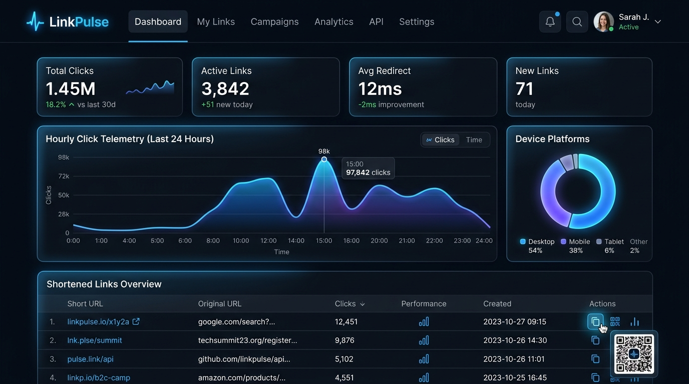
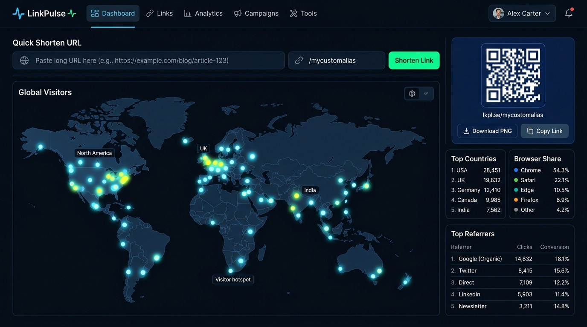
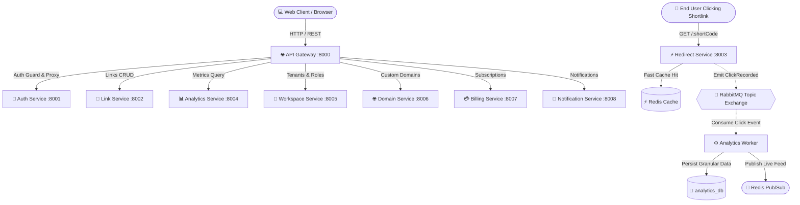

# ⚡ LinkPulse — Enterprise URL Shortener & Real-Time Analytics SaaS Platform

<p align="center">
  
  
  
  
  
  
  
  
  
</p>

---

## 📸 Platform Previews

### 📊 Real-Time Telemetry & Links Dashboard (Dark Mode)


### 🌍 Global Visitor Geographics & Dynamic QR Studio


---

## 🚀 Overview

**LinkPulse** is a distributed, event-driven URL shortening and click telemetry platform engineered for high-throughput link management, sub-millisecond edge redirection, and real-time visitor intelligence. Built as a scalable microservices architecture with Next.js 15 on the frontend and an asynchronous message-driven backend, LinkPulse provides enterprise-grade performance, multi-tenant workspace isolation, and granular click analytics.

---

## ✨ Key Features

- **⚡ High-Velocity URL Shortening**: Collision-safe cryptographic shortcodes, custom aliases, UTM parameter builders, and link expiration tags.
- **🏎️ Sub-Millisecond Redirects**: Redis-cached routing returning instant `301/302` HTTP redirects while non-blocking telemetry is offloaded asynchronously.
- **📈 Real-Time Granular Analytics**: Live click stream velocity, geographic country breakdowns, device hardware classification, browser distribution, and referrer attribution.
- **🎨 Vector QR Code Studio**: Instant client-side generation and export of dynamic, branded SVG/PNG QR codes with embedded icons and styling.
- **🏢 Multi-Tenant Workspaces & RBAC**: Isolate projects across distinct workspaces with team member roles (Owner, Admin, Member, Viewer).
- **🌐 Custom Branded Domains**: Support for custom CNAME domain mapping with SSL verification.
- **💳 Stripe Subscription Billing**: Integrated checkout flows, plan limits (clicks, links, domains), customer billing portals, and idempotent webhook handlers.
- **🌙 Permanent Dark Mode UI**: Modern, glassmorphism-enhanced dark interface with responsive navigation, micro-interactions, and Recharts telemetry graphs.

---

## 🏛️ System Architecture

LinkPulse is partitioned into independent, decoupled microservices connected via an API Gateway and an asynchronous message broker:



### Microservices Catalog

| Service | Port | Description | Database |
|---|---|---|---|
| **API Gateway** | `8000` | Reverse proxy, JWT authentication guard, rate limiter, request correlation IDs | Stateless |
| **Auth Service** | `8001` | User registration, Argon2/Bcrypt password hashing, token rotation, sessions | `auth_db` |
| **Link Service** | `8002` | Shortcode generation, custom slug validation, link expiration, QR parameters | `link_db` |
| **Redirect Service** | `8003` | Edge redirection, sub-millisecond Redis lookups, async event publishing | `link_db` (read) + Redis |
| **Analytics Service**| `8004` | Time-series click aggregation, geo-distribution, device/browser stats | `analytics_db` |
| **Workspace Service**| `8005` | Multi-tenant organization boundaries, member invites, RBAC policies | `workspace_db` |
| **Domain Service** | `8006` | Branded domain registration, DNS CNAME verification, SSL status checks | `domain_db` |
| **Billing Service** | `8007` | Stripe checkout session creation, portal redirects, idempotent webhook handling | `billing_db` |
| **Notification Service**| `8008`| In-app notification vault and event-triggered alerting | `notification_db` |

---

## 🛠️ Technology Stack

### Frontend
- **Framework**: [Next.js 15 (App Router)](https://nextjs.org/) + [React 19](https://react.dev/)
- **Language**: [TypeScript](https://www.typescriptlang.org/)
- **Styling**: [Tailwind CSS 3.4](https://tailwindcss.com/) with custom dark-mode glassmorphic theme
- **Data Fetching & State**: [TanStack Query v5](https://tanstack.com/query/latest) + [Zustand](https://github.com/pmndrs/zustand)
- **Charts & Graphs**: [Recharts](https://recharts.org/)
- **Animations**: [Framer Motion](https://www.framer.com/motion/) + [Canvas Confetti](https://www.npmjs.com/package/canvas-confetti)
- **QR Engine**: [qrcode.react](https://www.npmjs.com/package/qrcode.react)

### Backend & Infrastructure
- **Runtimes**: Node.js & TypeScript
- **Database Engine**: PostgreSQL 16 (Multi-database per service with Prisma ORM)
- **Cache & Key-Value**: Redis 7
- **Message Broker**: RabbitMQ 3.13 (Topic exchanges, durable queues, DLQ)
- **Containerization**: Docker & Docker Compose
- **Payments**: Stripe Billing API & Webhooks

---

## 📁 Repository Structure

```
.
├── backend/
│   ├── api-gateway/            # Unified routing, security, auth guards
│   ├── shared/                 # Shared logging, error handlers, event contracts
│   └── services/
│       ├── auth-service/       # Identity & authentication
│       ├── link-service/       # Link creation, validation, management
│       ├── redirect-service/   # Fast edge redirection with Redis caching
│       ├── analytics-service/  # Click aggregation and reporting
│       ├── workspace-service/  # Multi-tenant teams & permissions
│       ├── domain-service/     # Custom branded domains & CNAME
│       ├── billing-service/    # Stripe subscriptions & webhooks
│       └── notification-service/# Notifications and alerting
├── frontend/
│   ├── src/
│   │   ├── app/                # Next.js App Router (Dashboard, Analytics, Links, Settings)
│   │   ├── components/         # Reusable UI cards, tables, modals, layout
│   │   ├── hooks/              # Custom TanStack Query mutation & query hooks
│   │   ├── services/           # Typed API Client and microservice clients
│   │   └── store/              # Zustand global client stores
│   └── tailwind.config.ts      # Custom dark theme configuration
├── docs/                       # Architecture diagrams and deep-dive specifications
│   └── screenshots/            # UI preview captures
├── infrastructure/             # Docker configurations and init scripts
├── docker-compose.yml          # One-command orchestration
└── README.md
```

---

## 🏁 Quick Start

### Prerequisites
- [Docker](https://www.docker.com/) & [Docker Compose](https://docs.docker.com/compose/)
- [Node.js 20+](https://nodejs.org/) (for local frontend development)

### 1. Clone the Repository
```bash
git clone https://github.com/Nati1-2/URL-Shortener-project-.git
cd URL-Shortener-project-
```

### 2. Configure Environment Variables
Copy the sample environment file:
```bash
cp .env.example .env
```
Ensure your database credentials, JWT secrets, and optional Stripe keys are configured.

### 3. Spin Up with Docker Compose
```bash
docker compose up --build -d
```

### 4. Access Services
- 🖥️ **Web Application**: [`http://localhost:3000`](http://localhost:3000)
- 🌐 **API Gateway**: [`http://localhost:8000/api/v1`](http://localhost:8000/api/v1)
- ⚡ **Redirect Engine**: [`http://localhost:8003/:shortCode`](http://localhost:8003/)
- 🐰 **RabbitMQ Dashboard**: [`http://localhost:15672`](http://localhost:15672) (User: `guest`, Pass: `guest`)

---

## 🧪 Frontend Local Development

If you wish to run the Next.js frontend outside Docker:

```bash
cd frontend
npm install
npm run dev
```
Open [`http://localhost:3000`](http://localhost:3000) in your browser.

To verify production compilation:
```bash
npm run build
```

---

## 📜 Documentation & Guides
- 📐 [Architecture Deep-Dive](docs/architecture.md)
- 📡 [Microservices Catalog](docs/services.md)
- 🐰 [Event-Driven Architecture](docs/events.md)
- 💻 [Local Development Guide](docs/local-development.md)

---

## 📄 License
This project is licensed under the [MIT License](LICENSE).
